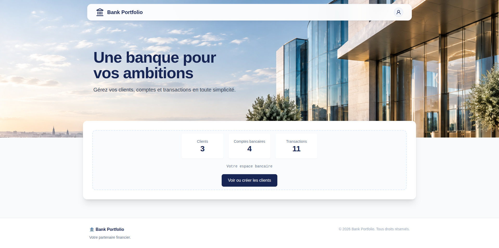
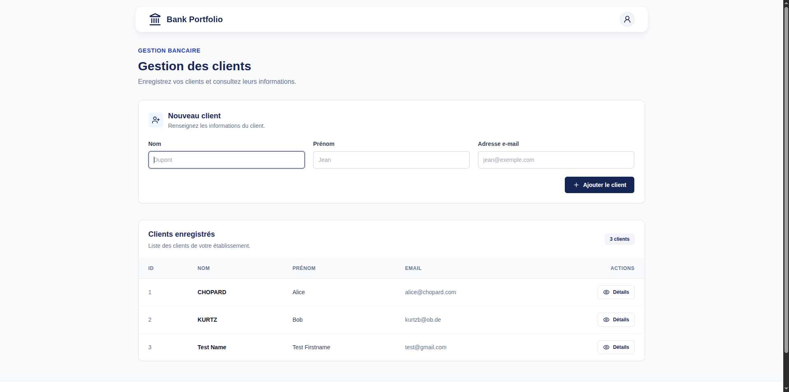
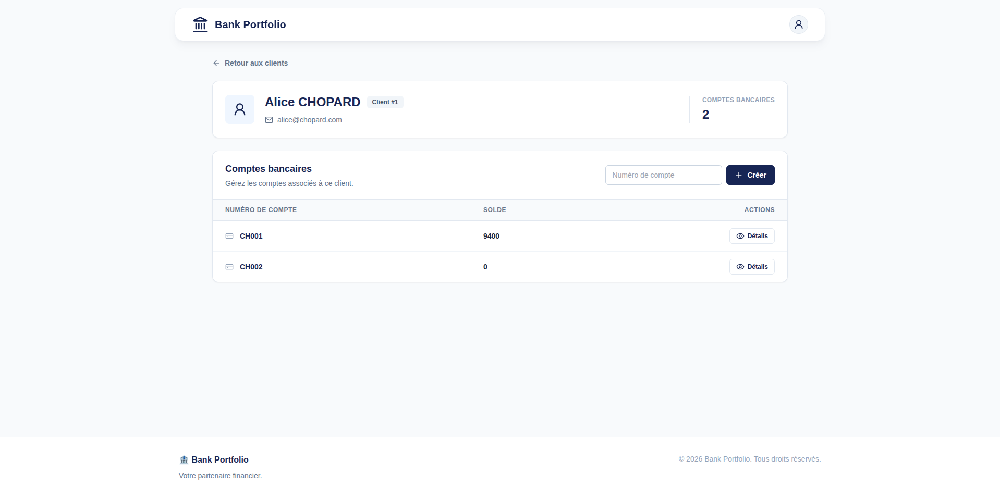
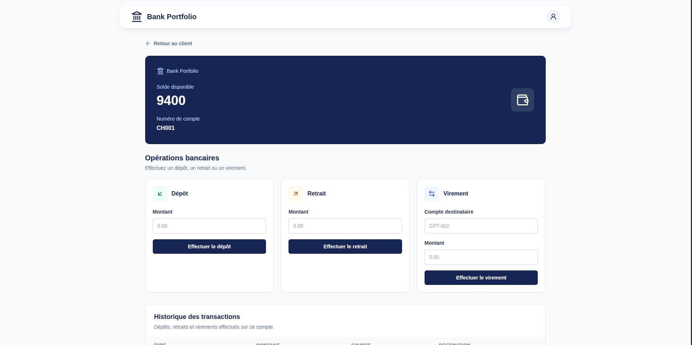
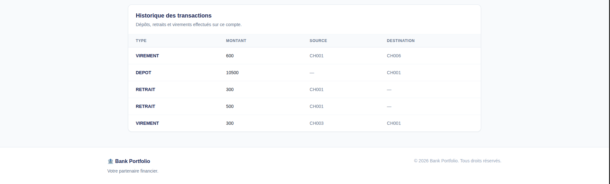

# Bank Portfolio Manager (Spring Boot)

A banking management web application built with **Java 21, Spring Boot, Thymeleaf, JDBC, and SQLite**.

The application provides a web interface for managing bank clients, accounts, and financial transactions.

## Features

- Client registration and management
- Bank account creation and consultation
- Deposits and withdrawals
- Transfers between bank accounts
- Authorized overdraft management
- Transaction history
- Persistent storage using SQLite
- SQL transaction management with `commit()` and `rollback()`
- Responsive web interface using Thymeleaf and Tailwind CSS

## Screenshots

### Home Page



### Client Management



### Bank Accounts



### Account Details



### Transaction History



## Tech Stack

| Technology | Purpose |
|---|---|
| Java 21 | Backend development |
| Spring Boot | Application framework |
| Spring MVC | HTTP request handling |
| Thymeleaf | Server-side HTML rendering |
| Tailwind CSS | User interface styling |
| JDBC | Database access |
| SQLite | Relational database |
| Maven | Dependency management and build |

## Architecture

The application follows a layered architecture:

```text
              Web Browser
                   |
                   v
          Spring MVC Controllers
                   |
                   v
             BanqueService
                   |
                   v
               Repositories
                   |
                   v
                 JDBC
                   |
                   v
                SQLite
```

### Project Structure

```text
src/main
├── java/com/example/bank_portfolio_web/
│   ├── controllers/    # Spring MVC controllers
│   ├── database/       # Database connection
│   ├── forms/          # Form objects
│   ├── models/         # Domain models
│   ├── repositories/   # JDBC data access
│   ├── services/       # Business logic
│   ├── types/          # Enumerations
│   └── BankPortfolioWebApplication.java
└── resources/
    ├── application.properties
    ├── static/         # Static assets
    └── templates/      # Thymeleaf templates
```

### Design Principles

- **Separation of concerns:** controllers handle web requests, services implement business logic, and repositories manage data access.
- **Object-oriented programming:** domain models represent clients, accounts, and transactions.
- **Database consistency:** financial operations use SQL transactions to support rollback on failure.
- **Server-side rendering:** Spring MVC and Thymeleaf generate HTML pages.

## Getting Started

### Prerequisites

- Java 21
- Maven

### 1. Clone the Repository

```bash
git clone https://github.com/romualdfolly/bank-portfolio-spring-boot.git
cd bank-portfolio-spring-boot
```

### 2. Database Setup

The application uses SQLite for data persistence.

The database file (`database/bank.db`) is **automatically created when the application starts**.

The database schema is available at:

```text
database/schema.sql
```

No manual database setup is required.

### 3. Run the Application

```bash
./mvnw spring-boot:run
```

Open your browser at:

**http://localhost:8080**

## Database

The application uses SQLite and JDBC for persistence.

The database is organized around three main domain entities:

- **Client:** stores customer information.
- **Compte:** represents a bank account and its balance.
- **Transaction:** records banking operations and their history.

The SQLite database file is excluded from version control.

## Project Evolution

This project is the Spring Boot web version of an initial **Java SE banking application**, available at [Bank Portfolio Manager — Java CLI](https://github.com/romualdfolly/bank-portfolio-manager-java-cli).

The development evolved through two stages:

1. **Java SE + JDBC + SQLite:** implementation of the banking domain, database repositories, and financial operations.
2. **Spring Boot + Spring MVC + Thymeleaf:** integration of the existing banking logic into a web application with controllers and HTML templates.

This repository focuses on the traditional banking web application, without AI or MCP integrations.
